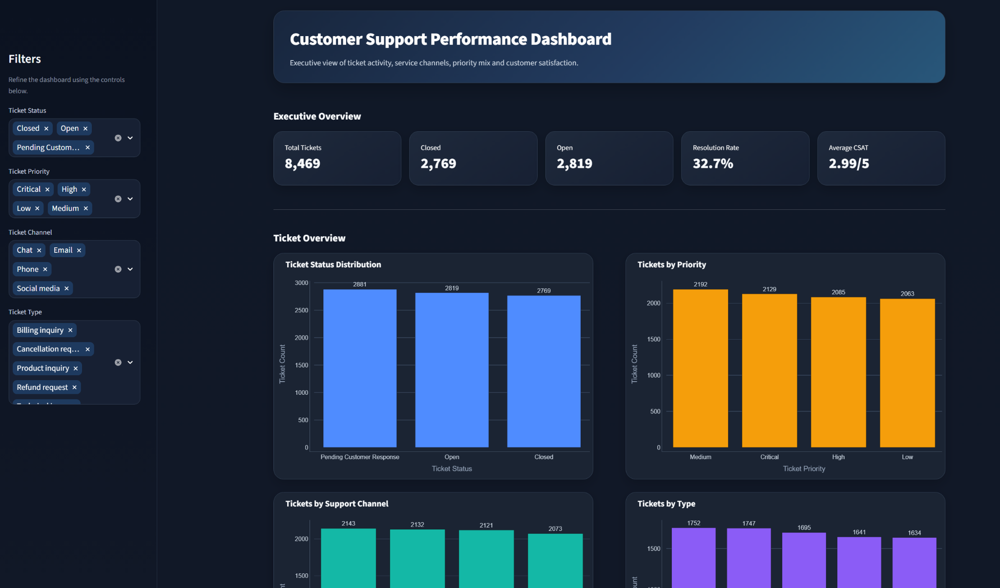
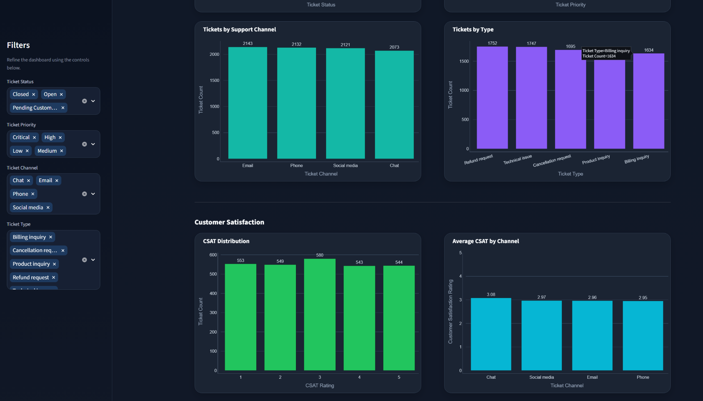
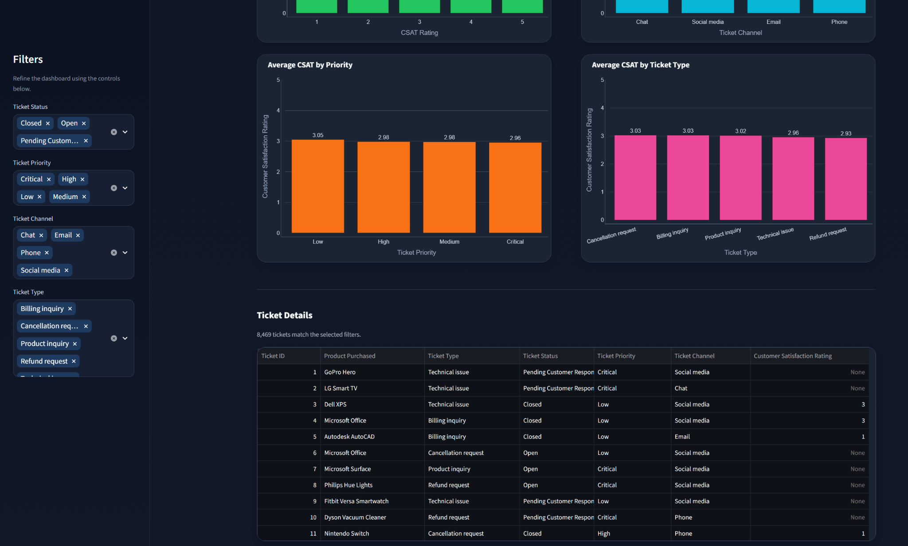

# 📊 Customer Support Performance Dashboard

A professional interactive analytics dashboard for exploring customer support ticket activity, service channels, priorities, ticket types, and customer satisfaction.

This project combines exploratory data analysis in Jupyter Notebook with a polished Streamlit dashboard for interactive business reporting.

---

## ✨ Dashboard Preview

### Executive Overview

The dashboard provides high-level KPIs and interactive filters for exploring ticket performance.



### Customer Satisfaction Analysis

The CSAT section compares customer satisfaction across support channels, ticket priorities, and ticket types.



### Ticket Details

The dashboard also includes a record-level table that updates based on the selected filters.



---

## 🎯 Project Objectives

The goal of this project was to analyze customer support activity and build an interactive dashboard that could help a support team quickly understand:

- Overall ticket volume
- Ticket status distribution
- Priority mix
- Support channel usage
- Most common ticket types
- Customer satisfaction patterns
- Filtered ticket-level details

---

## 📌 Key Metrics

The dataset contains **8,469 customer support tickets**.

Main KPIs include:

- **Total Tickets:** 8,469
- **Closed Tickets:** 2,769
- **Open Tickets:** 2,819
- **Pending Customer Response:** 2,881
- **Resolution Rate:** 32.7%
- **Average CSAT:** 2.99 / 5

---

## 📈 Key Business Insights

- Ticket volume is relatively balanced across ticket statuses.
- **Pending Customer Response** is the largest status group.
- **Medium-priority tickets** have the highest ticket volume.
- **Email** is the most frequently used support channel.
- **Refund requests** are the most common ticket type, followed closely by Technical Issues.
- Customer satisfaction is centered around approximately **3 out of 5**.
- **Chat** has the highest average CSAT among the support channels.
- **Phone** has the lowest average CSAT.
- **Low-priority tickets** have slightly higher satisfaction than Critical, High, and Medium priority tickets.
- The dataset does not contain a true ticket creation timestamp, so purchase dates were not used to calculate support response or resolution duration metrics.

---

## 🧠 Analysis Workflow

The analysis was completed in the Jupyter Notebook before building the dashboard.

The workflow included:

1. Loading and inspecting the dataset
2. Checking data types
3. Identifying missing values
4. Checking for duplicate records
5. Converting date and timestamp fields
6. Investigating ticket categories
7. Calculating business KPIs
8. Creating summary tables
9. Building exploratory visualizations
10. Saving a cleaned dataset for the Streamlit dashboard

---

## 📊 Dashboard Features

The Streamlit dashboard includes:

- Executive KPI cards
- Interactive sidebar filters
- Ticket status analysis
- Ticket priority analysis
- Support channel analysis
- Ticket type analysis
- CSAT distribution
- CSAT by support channel
- CSAT by priority
- CSAT by ticket type
- Filtered ticket-level data table
- Responsive Plotly visualizations
- Professional dark dashboard theme

---

## 🔍 Interactive Filters

The dashboard can be filtered by:

- Ticket Status
- Ticket Priority
- Ticket Channel
- Ticket Type

All KPI cards, charts, and the ticket table update automatically based on the selected filters.

---

## 🛠️ Tech Stack

- Python
- Pandas
- NumPy
- Matplotlib
- Seaborn
- Plotly
- Streamlit
- Jupyter Notebook

---

## 📁 Project Structure

```text
customer-support-dashboard/
│
├── data/
│   ├── customer_support_tickets.csv
│   └── customer_support_clean.csv
│
├── images/
│   ├── dashboard_overview.png
│   ├── dashboard_csat.png
│   └── dashboard_table.png
│
├── notebooks/
│   └── customer_support_analysis.ipynb
│
├── app.py
├── README.md
├── requirements.txt
└── .gitignore
```

---

# 🚀 How to Run

## 1. Clone the repository

## 2. Move into the project folder

```bash
cd customer-support-dashboard
```

## 3. Create a virtual environment

```bash
python -m venv .venv
```

## 4. Activate the virtual environment

For Windows PowerShell:

```powershell
Set-ExecutionPolicy -Scope Process -ExecutionPolicy Bypass
.\.venv\Scripts\Activate.ps1
```

## 5. Install the required packages

```bash
pip install -r requirements.txt
```

## 6. Launch the Streamlit dashboard

```bash
streamlit run app.py
```

The dashboard will open in your browser.

---

# 🖥️ How to Use

1. Launch the dashboard using:

```bash
streamlit run app.py
```

2. Use the **Filters** panel on the left side of the dashboard.

3. Select or remove values from:
   - Ticket Status
   - Ticket Priority
   - Ticket Channel
   - Ticket Type

4. Review the **Executive Overview** cards at the top.

5. Explore the ticket distribution charts.

6. Scroll to the **Customer Satisfaction** section to compare CSAT across different categories.

7. Scroll to the bottom to review the **Ticket Details** table.

8. Change the filters at any time to update the entire dashboard interactively.

---

## 📓 Jupyter Notebook

The notebook:

```text
notebooks/customer_support_analysis.ipynb
```

contains the full exploratory analysis, including:

- Data inspection
- Missing value analysis
- KPI calculations
- Category summaries
- CSAT comparisons
- Visualizations
- Business insights

---

## 🧹 Data Cleaning Notes

The original dataset contains missing values in:

- Resolution
- First Response Time
- Time to Resolution
- Customer Satisfaction Rating

These missing values were not blindly filled because many are associated with tickets that are not yet closed.

The dataset also contains a **Date of Purchase** field rather than a true ticket creation timestamp.

Because of this, purchase dates were not used to create response-time or resolution-time KPIs.

This avoids presenting misleading support performance metrics.

---

## 💡 What I Practiced

This project helped me practice:

- Data cleaning
- Exploratory data analysis
- KPI design
- Business-focused analysis
- Data visualization
- Interactive dashboards
- Streamlit development
- Plotly chart design
- Dashboard UI styling
- Filtering and dynamic reporting
- Communicating business insights
- Working with imperfect real-world datasets

---

## 🌱 Future Improvements

Possible improvements include:

- Adding a true ticket creation timestamp
- Adding agent-level performance metrics
- Adding SLA compliance analysis
- Adding ticket aging metrics
- Adding response-time and resolution-time analysis
- Adding exportable filtered reports
- Adding downloadable CSV results
- Adding a date-range filter when proper ticket dates are available

---

## 📌 Dataset

The project uses the **Customer Support Ticket Dataset** from Kaggle.

The dataset contains customer support tickets across different:

- statuses
- priorities
- channels
- ticket types
- products
- customer satisfaction ratings

---

## About the Project

This project was built as a professional data analytics portfolio project focused on turning customer support ticket data into clear, interactive business insights.

The final solution combines notebook-based analysis with an interactive Streamlit dashboard to demonstrate both analytical reasoning and dashboard development.